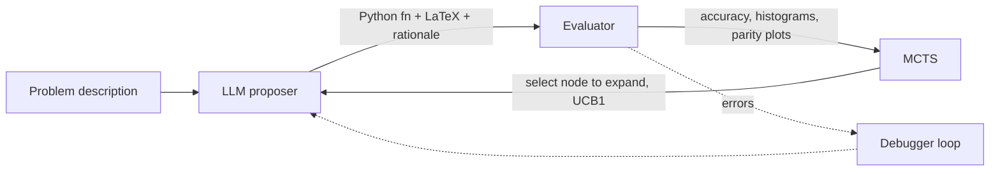

# LLM-MCTS Descriptor Discovery

**An LLM-guided Monte Carlo Tree Search agent that discovers interpretable mathematical descriptors for materials science.**

An LLM proposes candidate formulas, classifiers score them against labeled data, and MCTS decides which directions to explore next. This lets the search use the scientific knowledge already built into state-of-the-art LLMs while staying anchored to real data.

**First benchmark: perovskite stability.** The goal is to rediscover and surpass the tolerance factor τ from [Bartel et al. (2019)](https://doi.org/10.1126/sciadv.aav0693). τ classifies 576 ABX₃ compounds with about 92% accuracy, compared with about 74% for the classical Goldschmidt tolerance factor *t*.

> Developed by **Rishab Bamzai** as a Machine Learning Research Assistant in **Prof. Haizhao Yang's** group at the **University of Maryland**, mentored by PhD student **Youran Sun**.

---

## Results

| Descriptor | Source | Accuracy (576 ABX₃) |
|---|---|---|
| Goldschmidt *t* | Goldschmidt (1926) | ~74% |
| τ | Bartel et al. (2019) | ~92% |
| **Best discovered formula** | **This agent** | **_TBD_** |

<!-- When you have a result: put the discovered formula in LaTeX here, along with its accuracy, the LLM model used and the formula budget. Add the parity plot or histogram the agent produced. -->

---

## How it works



1. **Propose.** Given a problem description, the LLM writes candidate descriptors: an executable Python function, a LaTeX expression, and an explanation of the physical reasoning behind it.
2. **Evaluate.** Each formula is scored by how well it classifies the labeled data, using decision trees, SVMs and similar classifiers.
3. **Feed back.** Metrics and plots (accuracy, histograms, parity plots) go back to the LLM as text and images, so the next round of proposals improves on the last.
4. **Search.** MCTS with UCB1 balances refining promising formulas against exploring new ones. This makes the search systematic rather than greedy prompting.
5. **Recover.** A debugging loop catches formulas that fail to run and asks the LLM to repair them, so one bad formula doesn't waste the search budget.

### Key design choices
- **Multimodal feedback:** the proposer sees evaluation plots, not just a number, so it can reason about *where* a formula separates classes poorly.
- **Persistent, resumable state:** every run saves its full search tree, so long or interrupted runs can resume where they stopped.
- **Config-driven experiments:** [Hydra](https://hydra.cc/) lets you change the budget, model and search parameters from the command line without editing code.

---

## Setup

Requires [uv](https://docs.astral.sh/uv/).

```bash
# Clone with submodules (includes Bartel et al. data & code)
git clone --recurse-submodules https://github.com/rbamzai21/llm-mcts-descriptor-discovery.git
cd llm-mcts-descriptor-discovery

# If already cloned without submodules
git submodule update --init --recursive

# Install dependencies
uv sync --all-extras

# Install pre-commit hooks
uv run pre-commit install
```

## Running the search

```bash
# Add your OpenAI API key (.env is gitignored; never commit it)
echo "OPENAI_API_KEY=sk-..." > .env

# Run the search (default: 50-formula budget, GPT-4.1 Nano)
uv run python run_search.py

# Override config values
uv run python run_search.py mcts.budget=100 llm.model=gpt-4o-mini

# Resume an interrupted search
uv run python run_search.py search.resume=search_runs/<run_name>/search_state.json
```

Each run writes its plots and a JSON state file to `search_runs/<timestamp>/`.

## Reproducing the baseline

Before searching, the `reproduce_evidence/` scripts check the pipeline against the published results:

| Script | Reproduces |
|---|---|
| `evidence1_abx3_classification.py` | Fig. 2A–C: τ vs. *t* classification on 576 ABX₃ compounds |
| `evidence2_double_perovskites.py` | τ on ICSD double perovskites |
| `evidence3_dft_correlation.py` | Fig. 2D: correlation with DFT decomposition energies |

```bash
uv run python reproduce_evidence/evidence1_abx3_classification.py
```

---

## Project structure

```
├── run_search.py               # Entry point for MCTS formula search
├── mcts.py                     # MCTS: UCB1 selection, expansion, backpropagation
├── proposer.py                 # LLM prompt construction (text + vision)
├── evaluator.py                # Scores formulas on the 576 ABX₃ dataset
├── debugger.py                 # Error-recovery loop for failing formulas
├── llm_client.py               # OpenAI API wrapper (text + vision)
├── state.py                    # Persistent, resumable search state
├── conf/config.yaml            # Hydra configuration
├── reproduce_evidence/         # Scripts reproducing Bartel et al. figures
├── perovskite-stability/       # Submodule: Bartel et al. data & code
├── legacy/                     # Earlier prototype
├── bartel2019-new-tolerance-factor.md   # Notes on the benchmark paper
├── pyproject.toml
└── .pre-commit-config.yaml
```

## Roadmap

- [ ] Beat τ's ~92% accuracy on the ABX₃ benchmark
- [ ] Compare LLMs (cost vs. quality of discovered formulas)
- [ ] Extend to other descriptor tasks, such as collective variables

---

## Acknowledgments

This work was done in Prof. Haizhao Yang's research group at the University of Maryland. Thanks to Youran Sun for mentorship throughout the project.

## References

Bartel, C. J., Sutton, C., Goldsmith, B. R., Ouyang, R., Musgrave, C. B., Ghiringhelli, L. M., & Scheffler, M. (2019). New tolerance factor to predict the stability of perovskite oxides and halides. *Science Advances*, 5(2), eaav0693. https://doi.org/10.1126/sciadv.aav0693